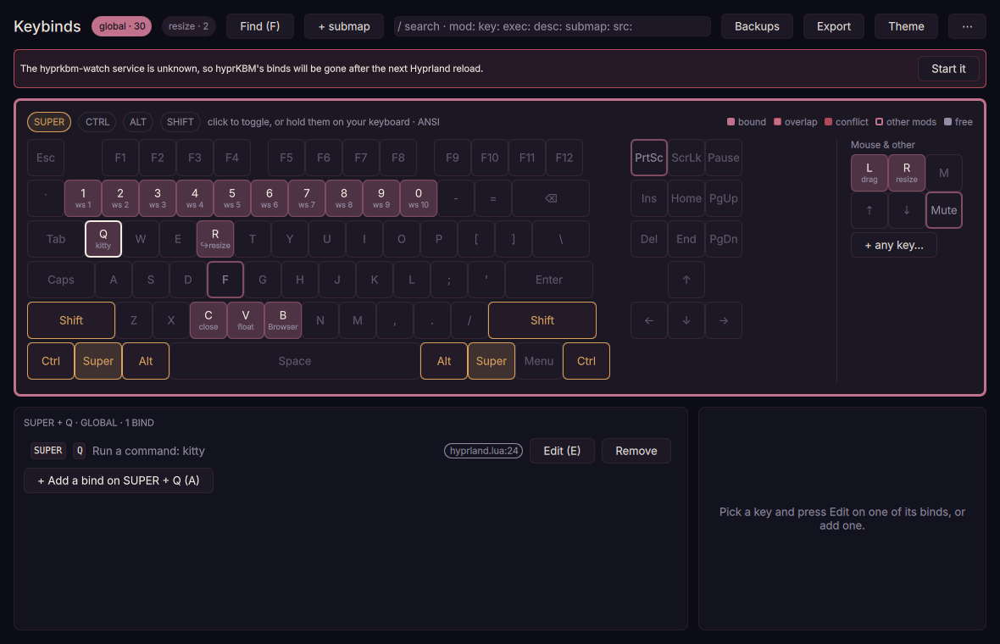
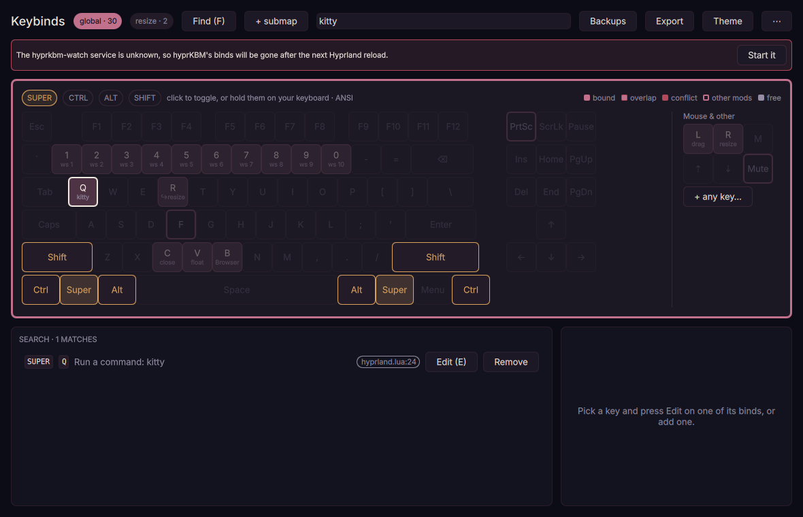
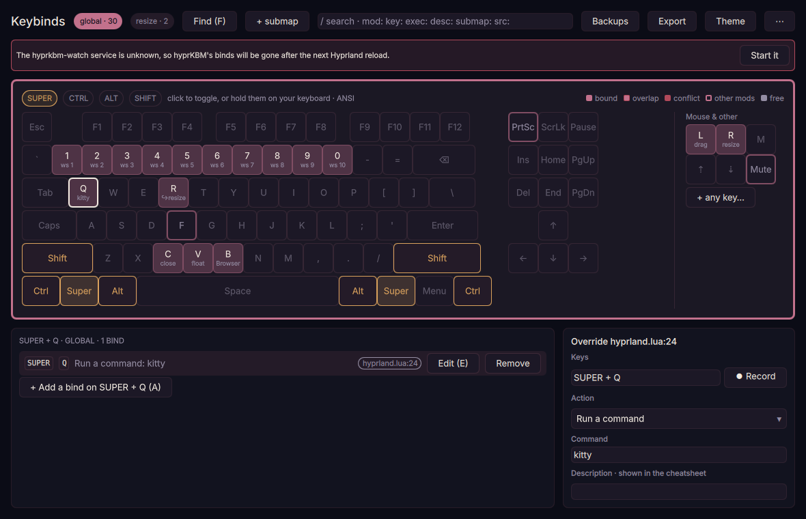
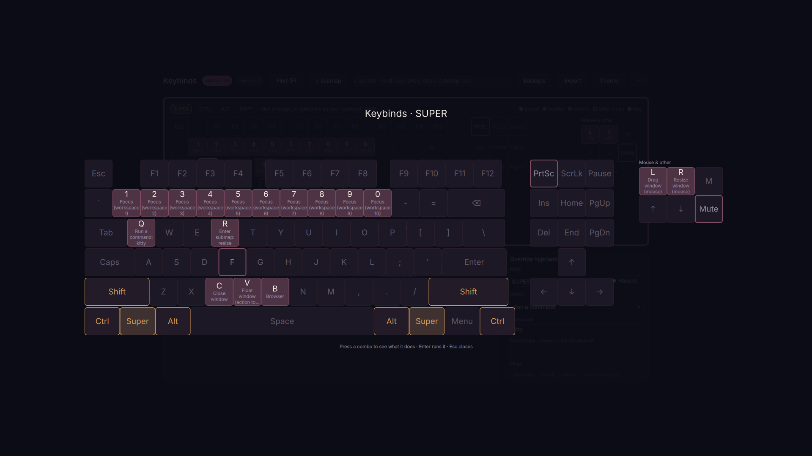

# hyprKBM


[](https://github.com/phos-org/hyprKBM/actions/workflows/ci.yml)
[](https://github.com/phos-org/hyprKBM/releases)
[](https://phos.sh)


[](LICENSE)

**hyprKBM** is a keybind manager for Hyprland's Lua configuration, from the
[phos](https://phos.sh) family. It shows every keybind you have, the ones
you wrote in `hyprland.lua` and its own, and adds, overrides, or removes
binds without editing your config.

The **keyboard panel** shows every bind on an on-screen keyboard. The
**cheatsheet** puts the same keyboard over your screen at a keypress.

## What it does

- It reads the binds you wrote. Your `hyprland.lua` is run in a sandbox against a stand-in for `hl` that records every bind, which is what gets loops, helper functions, and `mainMod ..` right. `hyprctl binds` cannot help here. It reports every Lua bind as an opaque `__lua` reference.
- It adds, overrides, and removes binds from `~/.config/hyprkbm/keybinds.json`, and it does not edit `hyprland.lua`. The one line you add yourself is the watcher hook when systemd cannot start it. See [Without systemd](docs/installation.md#without-systemd).
- It keeps them applied. The `hyprkbm-watch` user service puts hyprKBM's binds back after every Hyprland reload and at login.
- It checks before it changes anything. Conflicts with your other binds are refused, every apply is tried inside Hyprland first, and if Hyprland still refuses the result, your previous binds are put back.
- It shows a cheatsheet over the screen. Hold modifiers to see what they do, press a combo to see its action, and press Enter to run it.
- It exports a cheatsheet as Markdown, grouped by submap and modifiers.

## The panel

Run `hyprkbm`, or open **Keybinds** from your launcher. The window floats, centred, at 1180 by 760. Running it again focuses the open panel.



Hold a modifier, or click one, and the keys that are bound under it light up. Click a key to list what it does.





Search, submaps, conflicts, and apply are all in that window. Do not close the panel while it says **Applying…**. Closing it stops the helper mid-apply. The gestures and the keyboard shortcuts are in [Use hyprKBM](docs/usage.md).

## The cheatsheet



`hyprkbm --cheatsheet` toggles a full-screen keyboard of your global binds. Enter runs the combo you pressed. It writes nothing. Details are in [Show the cheatsheet](docs/usage.md#show-the-cheatsheet).

## Install

Hyprland 0.55 or later, with `hyprland.lua`. Python 3 from the standard library. A Lua 5.4 or 5.5 interpreter. Quickshell 0.3 or later (`qs`) for the panel and the cheatsheet. systemd is optional, and it is how the watcher starts with the session.

From a clone, which is also the way to follow `main`:

```bash
git clone https://github.com/phos-org/hyprKBM.git ~/src/hyprKBM
~/src/hyprKBM/install.sh
hyprkbm --status
```

`install.sh` symlinks the tools into `~/.local/bin` and enables `hyprkbm-watch`. Packages, the Nix flake, `make install`, and a machine without systemd are in [Install hyprKBM](docs/installation.md).

## Documentation

| | |
| --- | --- |
| [Install hyprKBM](docs/installation.md) | Packages, the Nix flake, `install.sh`, systemd, and uninstalling. |
| [Use hyprKBM](docs/usage.md) | The panel, the cheatsheet, and the commands. |
| [Configuration](docs/configuration.md) | Where the files live, `settings.json`, and backups. |
| [Keybind format](docs/keybind-format.md) | `keybinds.json`, actions, flags, overrides, and unbinds. |
| [How hyprKBM applies binds](docs/how-it-works.md) | The sandbox, apply, the watcher, and conflicts. |
| [Troubleshooting](docs/troubleshooting.md) | A watcher that is not running, a config that will not read, and going back to a backup. |

The index of those pages is [docs/README.md](docs/README.md). Packaging recipes are in [packaging/README.md](packaging/README.md). Theme colours are in [Theme presets](quickshell/hyprkbm/presets/README.md).

## Contributing

See [CONTRIBUTING.md](CONTRIBUTING.md). The suites run without a compositor and never touch your real config. `python3 -m pytest tests/ -q` and `npm test`. Changes are listed in [CHANGELOG.md](CHANGELOG.md).

## Licence

MIT. See [LICENSE](LICENSE).
